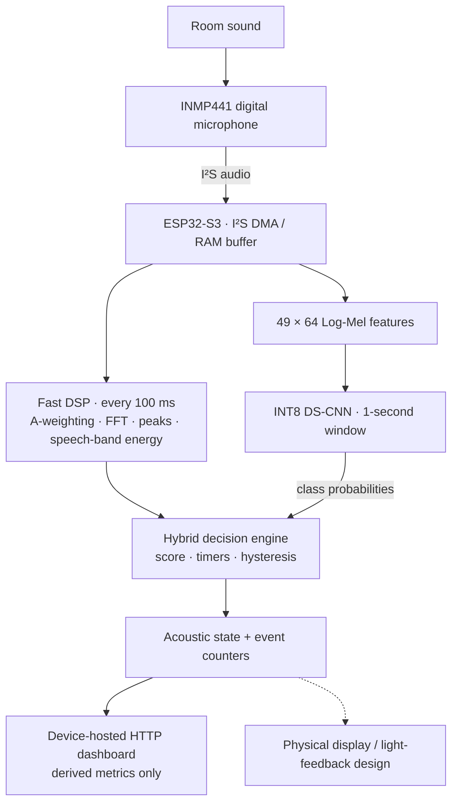

<div align="center">

# AuraSync

### Privacy-Preserving Acoustic Comfort Monitoring with Edge TinyML

**A sixth-semester minor project in Electronics, Communication and Information Engineering**  
Institute of Engineering · Thapathali Campus · Tribhuvan University

**ESP32-S3** · **Embedded C/C++** · **Digital Signal Processing** · **TinyML** · **Real-Time Systems**

[Project video / materials](https://drive.google.com/file/d/1x4ovi2Fx1pws_6r4OncqcAh-ii-xkip1/view?usp=sharing) · [How it works](#system-architecture) · [Results](#model-evaluation) · [Getting started](#getting-started)

</div>

---

## Overview

**AuraSync** is an edge-based acoustic comfort monitoring prototype designed for classrooms, study spaces, and shared workplaces. It interprets the *acoustic activity* of a room rather than simply reacting to loudness: continuous background sound, speech-dominant activity, and brief impulsive events can affect people differently.

Built around an **ESP32-S3** and an **INMP441 digital MEMS microphone**, AuraSync combines fast digital signal processing (DSP) with a compact, quantized convolutional neural network (CNN). A hybrid decision engine translates the results into understandable room states and makes anonymous status metrics available through a device-hosted web dashboard.

**The privacy principle is simple:** raw microphone samples are processed in volatile memory on the device. The documented firmware does not record, upload, or expose raw audio; its local interface reports derived metrics and acoustic states instead.

> **Designed to indicate acoustic comfort—not to record conversations or replace a certified sound-level meter.**

## At a glance

| | |
|---|---|
| **Platform** | ESP32-S3 with INMP441 I²S MEMS microphone |
| **Core approach** | Hybrid DSP + fully INT8-quantized depthwise-separable CNN (DS-CNN) |
| **Real-time processing** | DSP updates every 100 ms; CNN inference on 1-second audio windows |
| **ML input** | 49 × 64 Log-Mel spectrogram features |
| **Classification** | `stationary_background`, `speech_dominant`, `non_speech_activity` |
| **Feedback** | Acoustic state machine and local HTTP dashboard |
| **Privacy** | On-device processing; scalar telemetry rather than raw-audio streams |
| **Academic context** | Sixth-semester minor project, Thapathali Campus, IOE/TU (2026) |

## Why AuraSync?

Noise in shared spaces is not only about how loud a room is. Persistent talking, sudden claps, and steady ventilation noise can have different effects on concentration. Asking people to quiet down can itself be disruptive.

AuraSync explores a different approach: **continuous, non-judgmental feedback** that gives occupants an objective indication of the room's acoustic condition while keeping speech data local.

The project brings together several areas of electronics and computer engineering:

- **Embedded hardware:** I²S microphone interfacing and ESP32-S3 peripherals.
- **Signal processing:** A-weighted sound-level estimation, FFT analysis, speech-band energy, and transient detection.
- **On-device AI:** Small-footprint audio classification using TensorFlow Lite Micro-compatible INT8 inference.
- **Real-time firmware:** FreeRTOS task scheduling, temporal filtering, hysteresis, and state transitions.
- **Local visualization:** HTTP-based dashboard for live state and diagnostic information.

## System architecture



Two complementary paths improve interpretability and response behavior:

**1. DSP path — fast physical measurements.** The firmware processes audio in 100 ms intervals to estimate A-weighted level, RMS/peak behavior, speech-band energy, and spectral change. It can recognize loud or sharp events without waiting for the CNN.

**2. TinyML path — acoustic context.** Audio is represented as a 49 × 64 Log-Mel feature tensor and classified by a lightweight DS-CNN. Rather than treating every sound at the same level as equivalent, the model helps distinguish background conditions from speech-dominant and other activity.

The **fusion engine** combines both paths into a disturbance score and applies timing rules to avoid rapid state flickering. In the documented design, **LOUD** and **SPIKE** decisions are DSP-driven; CNN probabilities provide additional context for other transitions.

### Acoustic states

| State | Purpose |
|---|---|
| `SMOOTH` | Comfortable / baseline condition |
| `PRE_WARNING` | Early indication of sustained disturbance |
| `WARNING` | Persistent acoustic disturbance |
| `LOUD` | Sustained high-level sound detected by DSP |
| `RECOVERY` | Cooldown before returning to a comfortable state |
| `SPIKE` | Brief overlay for sudden impulsive sound |
| `MIC_ERROR` | Microphone fault indication |

These states are **behavioral indicators**, not a measurement of individual speakers or speech content.

## Hardware and embedded implementation

### Core hardware

| Component | Function | Implementation status in the July 2026 report |
|---|---|---|
| **ESP32-S3** | Audio acquisition, signal processing, inference, state logic, Wi-Fi | Firmware implemented |
| **INMP441 I²S microphone** | Digital acoustic input | Firmware interface implemented |
| **GC9A01 circular TFT + SSD1306 OLED** | Primary and secondary visual feedback | Designed / reserved for integration |
| **WS2812B LED ring** | Ambient state indication | Designed / reserved for integration |
| **Battery / charger and optional alert output** | Portable operation and optional feedback | Proposed hardware integration |

### Microphone connections

The firmware pin assignment documented for the **INMP441 → ESP32-S3** interface is:

| INMP441 signal | ESP32-S3 |
|---|---|
| `SCK / BCLK` | `GPIO 14` |
| `WS / LRCLK` | `GPIO 15` |
| `SD / DATA` | `GPIO 16` |
| `VDD` | `3.3 V` (use the microphone's specified supply) |
| `GND` | `GND` |

> Verify the microphone channel-select pin, the exact ESP32-S3 board variant, and the firmware's I²S configuration before wiring or powering the system. The display and LED allocations in the project report were planned allocations, not evidence that every peripheral was assembled.

### Firmware scheduling

The documented firmware separates time-sensitive audio work from the network interface:

- A dedicated **FreeRTOS audio task on Core 1** handles I²S acquisition, 100 ms DSP updates, 1-second CNN inference, and state updates.
- The **Arduino main loop** services the local web server and Wi-Fi reconnection without taking over the audio-processing task.
- Temporal confirmation and recovery logic help keep status changes stable in the presence of short-lived noise.

## Model evaluation

A curated dataset of **12,466 one-second clips** (16 kHz, mono) was partitioned into fixed training, validation, and test sets. The student DS-CNN was trained using a **YAMNet-based teacher/student workflow**, then fully quantized to INT8 for microcontroller deployment.

**Results reported on the held-out test set (1,876 clips):**

| Metric | Float32 student | INT8 student |
|---|---:|---:|
| Accuracy | 89.77% | **89.82%** |
| Balanced accuracy | 88.50% | **88.61%** |
| Macro-F1 | 88.90% | **88.95%** |
| Model size | 183.07 KB | **77,384 bytes (~75.6 KiB)** |

The quantized model maintains comparable held-out classification performance while reducing storage requirements. **These are offline test-set results, not a claim of equivalent performance in every real room.** Live acoustics, microphone placement, calibration, and background conditions require separate evaluation.

### What the model predicts

| Class | Examples |
|---|---|
| `stationary_background` | Fan, ventilation, and relatively steady room ambience |
| `speech_dominant` | Human speech as a prominent acoustic component |
| `non_speech_activity` | Non-speech events and miscellaneous acoustic activity |

The system does **not** attempt speech transcription, speaker identification, or voice recording.

## Local dashboard and privacy

The device-hosted dashboard provides a view of the current state and derived metrics, including estimated A-weighted sound level, disturbance score, CNN probabilities, event counts, and microphone diagnostics.

```text
INMP441 microphone
      |
      v
ESP32-S3 RAM: transient PCM samples
      |
      +--> DSP features and INT8 inference
                     |
                     v
          Acoustic state / scalar metrics
                     |
                     v
          Local HTTP dashboard / JSON API

No raw-audio recording or streaming in the documented firmware.
```

**Privacy boundary:** audio remains on-device for processing, and the local API exposes numerical indicators rather than audio waveforms. A local HTTP endpoint should still be deployed only on a trusted network; this design is not a substitute for network access controls.

## Getting started

This repository contains the AuraSync project materials and implementation. The steps below describe the hardware bring-up workflow; **use the build configuration and dependency versions supplied by the checked-out source**, since they may vary across revisions.

**1. Clone the repository**

```bash
git clone https://github.com/GhimirePlan/Project_AuraSync.git
cd Project_AuraSync
```

**2. Prepare the board.** Use an ESP32-S3 development board, an INMP441 microphone, suitable 3.3 V wiring, and a USB data cable. Confirm the I²S pin mapping above against the firmware.

**3. Build and flash.** Open the firmware project in the development environment configured by the repository (Arduino IDE or PlatformIO, as applicable). Install its declared libraries, select the matching ESP32-S3 board/port, configure local Wi-Fi settings if required, then upload.

**4. Inspect the output.** Open the serial monitor, verify microphone/audio initialization, and locate the device's local network address. Open the local dashboard on a device connected to the same network.

**5. Evaluate behavior.** Compare the states and diagnostics under controlled conditions (quiet room, speech, fan noise, and short impulses). Treat estimated sound levels as provisional until calibrated using a reference meter.

> The exact build target, source paths, Wi-Fi configuration keys, and HTTP routes should be taken from the repository's current firmware. They are intentionally not guessed here.

## Project scope and limitations

The **July 2026 academic progress report** documents working implementations of I²S capture, DSP diagnostics, INT8 DS-CNN inference, hybrid fusion, state timing, stored calibration settings, simulation controls, and the local HTTP dashboard.

It also identifies **complete physical-display/enclosure integration, controlled reference-meter calibration, field validation, and MQTT/remote analytics** as additional work or extensions. These are not presented as completed capabilities solely on the basis of that report.

AuraSync is an **academic acoustic-comfort prototype**, not a certified sound-level meter or a surveillance product.

## Academic project

Developed as a **sixth-semester minor project** in the **Department of Electronics and Computer Engineering, Thapathali Campus**, under the **Institute of Engineering, Tribhuvan University**, Nepal.

**Project team**

- Plan Ghimire
- Pranjal Shrestha
- Sagun Acharya
- Samman Ghale

**Project supervisor:** Er. Binod Sapkota  
**Academic report:** July 2026

### Project media

[**View the shared project video / materials on Google Drive →**](https://drive.google.com/file/d/1x4ovi2Fx1pws_6r4OncqcAh-ii-xkip1/view?usp=sharing)

---

<div align="center">

**AuraSync** · Embedded Systems × Signal Processing × Edge AI

*Built to make shared spaces more comfortable without listening to conversations.*

</div>
